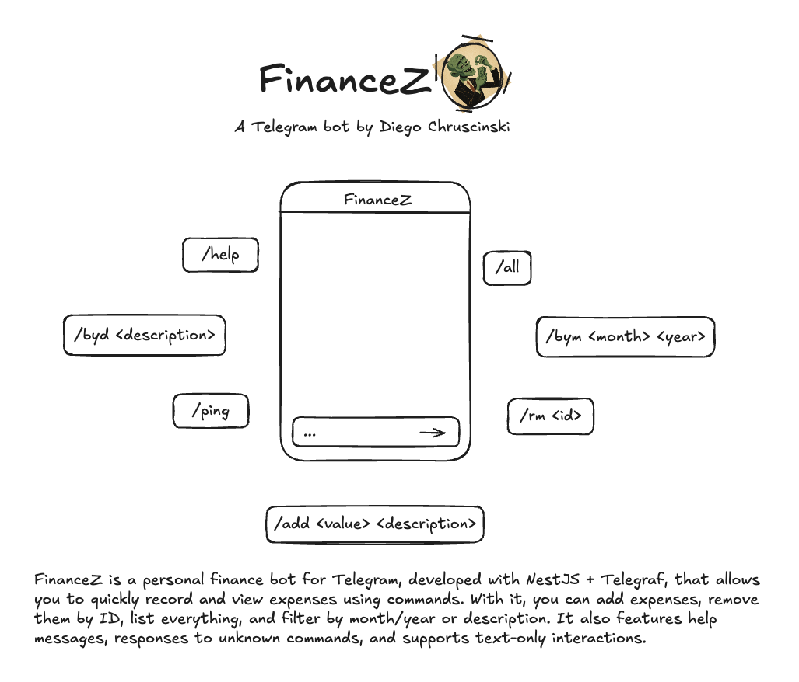

# FinanceZ 🧟💸

## 📖 About

**FinanceZ** is a personal finance assistant bot for **Telegram**, built with [NestJS](https://nestjs.com) and **nestjs-telegraf (Telegraf)**.  
It helps you **track expenses directly from chat** using simple commands like **add**, **delete**, **list**, and filters by **month/year** or **description**.

---

## Overview

  

---

## ✨ Tech stack

- **Framework:** NestJS
- **Language:** TypeScript
- **Bot framework:** Telegraf + nestjs-telegraf
- **Commands / updates:** Decorators (`@Command`, `@Start`, `@Help`, `@Hears`, `@On`)
- **Input parsing:** pt-BR number parsing (comma decimals) + arguments extraction

---

## 🚀 Key features

- **Onboarding & guidance**
  - `/start` welcome message
  - `/help` command list and usage instructions
  - `/ping` quick bot check + personalized reply

- **Expense management (chat-first)**
  - `/add <value> <description>` add a new expense  
    Example: `/add 150,20 Monthly subscription`
  - `/del <id>` delete an expense by id  
    Example: `/del 3`
  - `/all` list all expenses for the current user

- **Smart filters**
  - `/bym <month> <year>` list expenses by month/year  
    Example: `/bym 5 2023`
  - `/byd <description>` list expenses by description  
    Example: `/byd Mensalidade`

- **Friendly fallbacks**
  - Unknown commands return a clear message and point to `/help`
  - Non-command text messages receive a friendly “I didn’t understand” response
  - Unsupported content types (stickers/photos/docs/audio/etc.) are rejected with a helpful hint

---

## 🧾 Commands

| Command | Description | Example |
|--------|-------------|---------|
| `/start` | Starts the bot and shows the welcome message | `/start` |
| `/help` | Shows all available commands | `/help` |
| `/ping` | Health-check / greeting | `/ping` |
| `/add <value> <description>` | Adds a new expense | `/add 150,20 Mensalidade` |
| `/del <id>` | Deletes an expense by id | `/del 3` |
| `/all` | Lists all expenses | `/all` |
| `/bym <month> <year>` | Lists expenses by month/year | `/bym 5 2023` |
| `/byd <description>` | Lists expenses by description | `/byd Mensalidade` |

> **Note:** Values accept **pt-BR format**, e.g. `150,20`.

---

## ✅ Input validation behavior

- If `/add` is missing arguments, FinanceZ returns the correct usage format.
- If the value cannot be parsed (or the description is empty), it returns an example.
- For `/del`, if the id is invalid, it returns the proper usage.
- Messages starting with `/` that don’t match known commands are treated as **unknown commands**.
- Messages that do not start with `/` are treated as **unknown text**.
- Stickers/photos/documents/audio/video/location/contacts are treated as **unsupported** inputs.

---

_Developed by Diego Chruscinski_